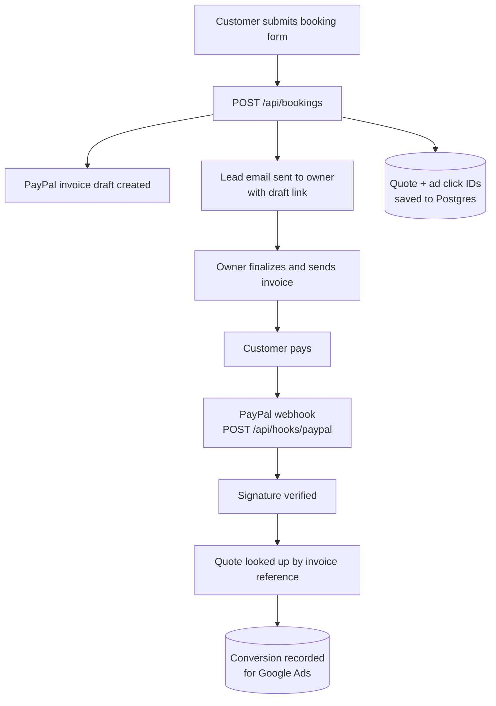

The backend for Cobalt Transportation, a private chauffeur and van service in Atlanta. 
It turns booking requests from the company website into instant leads
and PayPal invoice drafts for the owner, and traces paid invoices back to the
Google Ads click that brought each customer in. The site serves around 120 users a month.

### Results

**Faster form submissions.** The booking form used to take about 3 seconds to
respond. It now responds in under 1 second.

**Faster responses to new leads.** The owner used to take about 2 days to
respond to a new booking request. With an instant lead email and an invoice
draft already prepared, that's now under 1 hour.

**Ad spend tied to revenue.** There was no link between Google Ads clicks and
the money they brought in. Every paid invoice is now traced back to the ad
click that started it.

### How it works

### Case study

- **Faster form submissions**: an SMTP client that keeps its Gmail connection
  open in the background
- **Responding to leads within an hour**: templated lead emails and automatic
  PayPal invoice drafts
- **Knowing which ads make money**: verified PayPal webhooks that link paid
  invoices back to ad clicks
- **Lessons and next steps**: what I'd change and what's still open

### Stack

- Python 3.14 and Starlette
- PostgreSQL with asyncpg
- pydantic for validation
- Jinja2 for email templates
- httpx for the PayPal REST API
- Gmail SMTP
- Fly.io
