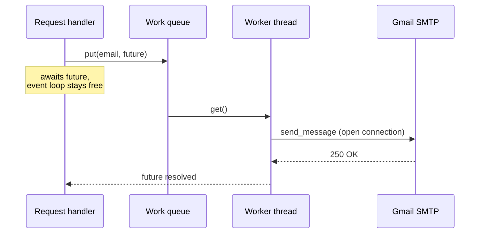

I built an SMTP email client that keeps its connection to Gmail open in the
background, cutting booking form submission time from about 3 seconds to under 1 second.

### The problem

Every booking request on the website sends an email to the business owner
before the customer sees a confirmation. Opening a new connection to Gmail's
mail server takes several round trips: a TCP connect, a STARTTLS handshake,
and a login. Doing that for each submission made the form take about 3 seconds
to respond, which is long enough for a customer to wonder whether it worked or
to click submit again.

<!-- TODO: confirm the old implementation opened a new connection per submission -->

### What I built

A small mail client, `Gmail`, that the server opens once at startup and shares
across every request.

**One long-lived connection.** It logs in once at startup. A background thread
sends a lightweight `NOOP` command on an interval so Gmail doesn't close the
connection while it's idle.

**Non-blocking sends.** Python's `smtplib` blocks the calling thread, so
request handlers don't call it directly. They put the email on a queue and
wait asynchronously. A dedicated worker thread sends it and reports the result
back to the request.

**Self-healing.** If Gmail drops the connection anyway, the client reconnects
and retries the send once, so a stale connection never reaches the customer as
an error.

### Result

Form submissions went from about 3 seconds to under 1 second, because the
connection setup moved out of the request path and now happens once when the
server starts.

<!-- TODO: how was this measured? (browser network tab, server logs, …) -->

### In this chapter

- **Threading model**: how async request handlers share one blocking SMTP
  connection with two background threads
- **Failure handling**: reconnects, the approaches I rejected, and shutting
  down cleanly
- **Testing concurrent code**: testing real threads without flaky sleeps
